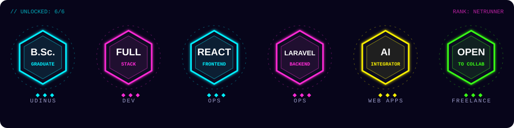
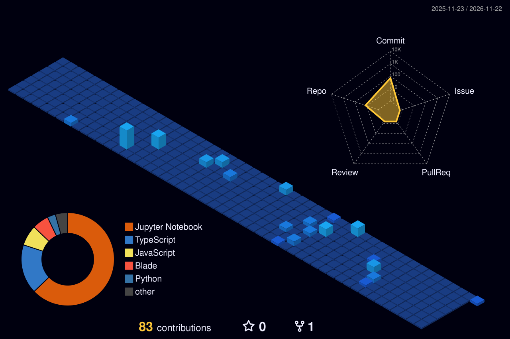

<!-- ╔══════════════════════════════════════════════════════════════╗
     ║  ANDHIKA RIZKY NUR WAHYU // CYBERPUNK PROFILE v2.077            ║
     ╚══════════════════════════════════════════════════════════════╝ -->

<div align="center">



<a href="https://github.com/AndhikaRizky04">
  
</a>

<br/>




<!-- ======================= ABOUT ======================= -->




</div>

> **Software Engineer & Full-Stack Developer** · Informatics Engineering Graduate (B.Sc) @ **Universitas Dian Nuswantoro**
> I build end-to-end web and mobile systems — from client landing pages and booking engines to internal management dashboards and AI-powered features.

```diff
+ 🔭 Currently  : a frontend redesign with React
+ 🌱 Exploring  : AI integration in web applications
! ⚡ Focus      : clean, scalable & maintainable code
- 🎯 Open to    : collaboration · freelance · new opportunities
```

<div align="center">


<!-- ======================= TECH STACK ======================= -->




<br/><br/>

<table>
<tr>
<td align="center"><b><code>// FRONTEND</code></b><br/><br/></td>
<td align="center"><b><code>// BACKEND</code></b><br/><br/></td>
<td align="center"><b><code>// TOOLS</code></b><br/><br/></td>
</tr>
</table>


<!-- ======================= WHAT I BUILD ======================= -->





<!-- ======================= STATS ======================= -->


<!-- ======================= TROPHIES ======================= -->





<!-- ======================= 3D CONTRIBUTION CITY ======================= -->
<!-- Dibuat otomatis oleh .github/workflows/profile-3d.yml -->




<!-- ======================= SNAKE ======================= -->


<picture>
  <source media="(prefers-color-scheme: dark)" srcset="https://raw.githubusercontent.com/AndhikaRizky04/AndhikaRizky04/output/github-snake-dark.svg" />
  <source media="(prefers-color-scheme: light)" srcset="https://raw.githubusercontent.com/AndhikaRizky04/AndhikaRizky04/output/github-snake.svg" />
  
</picture>


<!-- ======================= CONNECT ======================= -->


<a href="https://www.linkedin.com/in/andhikarizkynw"></a>
<a href="https://github.com/AndhikaRizky04"></a>
<a href="mailto:andhikawahyu65@gmail.com"></a>
<a href="https://instagram.com/dhkarzkyy"></a>

<br/><br/>



</div>
